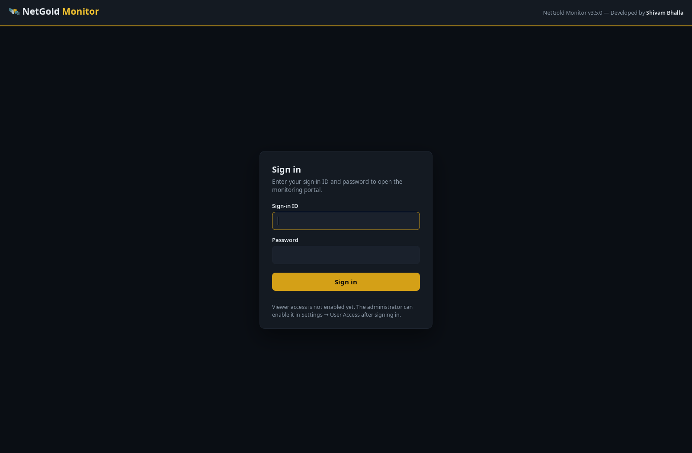
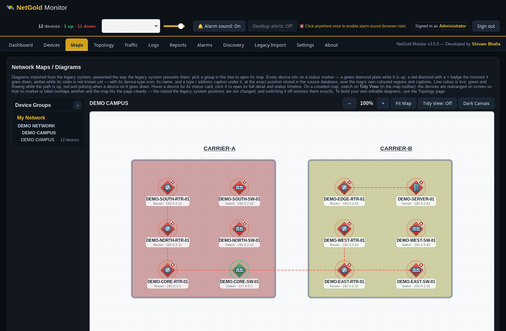

<p align="center">
  
</p>

<h1 align="center">NetGold Monitor</h1>

<p align="center">
  <a href="LICENSE"></a>
  
  
  
</p>

**Free, open-source network monitoring for IT professionals** — ping, SNMP
v2c/v3 and service monitoring, MRTG-style bandwidth graphs, network maps
and topologies, downtime reports and email alerts, in **one single file**
with no runtime, no database server and no setup.

Developed by **Shivam Bhalla** · MIT License · Works fully offline

---

## Quick start

Download the binary for your platform — the same single-file promise on
every platform:

| Platform | File |
|---|---|
| Windows (64-bit) | `NetGold-Monitor-Setup-v3.7.0.exe` (recommended installer) or `NetGold-Monitor-v3.7.0.exe` (portable) |
| Linux (64-bit) | `netgold` |
| macOS (Intel) | `netgold-darwin-amd64` |
| macOS (Apple Silicon) | `netgold-darwin-arm64` |

### Windows
Recommended: run the installer — see **Install on Windows** below.
The portable `NetGold-Monitor-v3.7.0.exe` also works by itself:
double-click it and the dashboard opens in your browser; the program
runs quietly in the system tray (no console window). On the first
run the portable copy installs itself to `%LOCALAPPDATA%\NetGold`
and continues from there — from then on there is exactly one
NetGold on the computer, and starting any copy replaces an older
running one automatically (see "What changed in v2.2.2"). For the
best ICMP ping results, run as Administrator; otherwise NetGold
falls back to the Windows `ping` command automatically.

### Linux / macOS
```bash
chmod +x netgold            # or netgold-darwin-arm64 on Apple Silicon
./netgold                   # dashboard on http://localhost:8080
./netgold -demo             # + a synthetic demo device so graphs render instantly
```

Flags: `-addr :8080` (listen address), `-data <dir>` (where the SQLite
database `netgold.db` lives; by default a `NetGold` folder in your
user profile — `%LOCALAPPDATA%\NetGold\data` on Windows,
`~/.config/NetGold/data` on Linux), `-interval 60s` (poll interval;
allowed range 10 s – 24 h, the same range the legacy system allows), `-netflow-port
2055`, `-sflow-port 6343`, `-syslog-port 5514` (set any collector
port to 0 to disable it), `-no-takeover` (never replace a running
copy of a different version; report it and exit instead). On Windows,
`-service install|uninstall|start|stop|status` manages the
**NetGoldMonitor** Windows service (see Platform notes).

First-look tip: run with `-demo`, open the demo device, click an
interface — you will see the MRTG-style in/out bandwidth graph
immediately, with no real network gear needed.

## Install on Windows

Run **`NetGold-Monitor-Setup-v3.7.0.exe`** (administrator approval is
asked once, for the install itself). The installer:

- installs **NetGold Monitor 3.7.0** by **Shivam Bhalla** into
  `C:\Program Files\NetGold Monitor`, with the program icon, a Start
  Menu folder ("NetGold Monitor" and "Uninstall NetGold Monitor"),
  an optional desktop shortcut, and a normal Add/Remove Programs
  entry with publisher and version;
- also installs **`engine\SqlLocalDB.msi`** — Microsoft's SQL Server
  LocalDB installer, the same pinned file the engine setup verifies —
  so the legacy system backup (.bak) import works **fully offline**;
- offers to stop a running NetGold copy before replacing its files,
  and finishes with "Run NetGold Monitor" ready to start the program.

**How the installed program behaves:** there is **no console
window**. NetGold runs in the background with an icon in the system
tray; the dashboard opens in your browser when it starts.
Double-clicking the tray icon reopens the dashboard, right-clicking
shows the menu, and **Exit NetGold Monitor** in that menu is the
clean way to stop it (closing the browser tab never stops it).
Program output that used to go to a console is written to
`netgold.log` in the data folder instead. Starting the program while
the same version is already running simply opens the running
dashboard in your browser; starting a newer version replaces the old
one. Removing the program (Settings > Apps, or the Start Menu
uninstaller) leaves your monitoring data in `%LOCALAPPDATA%\NetGold`
untouched.

Command-line use still works from a terminal: `NetGoldMonitor.exe
-version` prints the version, `-service
install|uninstall|start|stop|status` manages the **NetGoldMonitor**
Windows service, and `-help` lists all flags — those commands attach
to your terminal's console and print normally.

**Automatic repair on import:** if a backup import's engine install
fails (the classic case is Windows Installer error 1603, usually
leftovers of an earlier interrupted SQL setup), the Import page
offers **Repair and Retry**: NetGold removes the LocalDB leftovers
(LocalDB instances, LocalDB products, LocalDB registry keys — backed
up first — and leftover LocalDB folders), installs the engine
cleanly under one administrator approval, and then continues your
import automatically. A manual **Repair SQL Engine** action is on
the same page. The repair never touches a real SQL Server instance
(such as the one the legacy system uses) — it only ever handles items
named LocalDB.

## Windows SmartScreen / antivirus note

NetGold Monitor is an unsigned, open-source build. That means:

- On first run, Windows SmartScreen may show a **"Windows protected
  your PC"** prompt naming an *unknown publisher*. This is expected
  for a new unsigned program — SmartScreen reputation is earned by a
  file hash over time as more people download and run it, and it
  cannot be pre-earned for a first release. To proceed, choose
  **More info → Run anyway**. Entering the exact version is in the
  file name precisely so you can be sure which build you are running.
- You can verify your download: every release lists the SHA-256 of
  each file, and `Get-FileHash .\NetGold-Monitor-v3.7.0.exe` in
  PowerShell shows the hash of the file you have — it must match the
  published one exactly.
- The program is built to be easy for antivirus software to judge:
  a proper Windows application manifest, embedded icon and version
  information (product name, version, publisher), no packing, no
  obfuscation, no self-modifying behaviour, and it never downloads
  program code for itself (the only download is Microsoft's own
  signed SqlLocalDB.msi, signature-checked before use). If your
  antivirus still flags a file, please submit it to Microsoft as a
  false positive at
  https://www.microsoft.com/en-us/wdsi/filesubmission — and open an
  issue here so the hash can be tracked.
- The permanent fix for the SmartScreen prompt is a code-signing
  certificate (or Microsoft's Azure Trusted Signing) applied to the
  released files; that is planned for the public release. Until
  then, the prompt can appear — this note exists so it never comes
  as a surprise.

## User Access and sign-in

The portal is protected by a **sign-in page**: anyone who opens
NetGold's address — on this computer or from another computer on
the same network — must sign in before they can see anything.

- **First run:** the sign-in page offers a one-time setup,
  **"Create the admin password"**. After that it never appears
  again. The administrator signs in with the ID **`admin`**.
- **Two roles.** The **administrator** can view and change
  everything. A **viewer** sign-in is read-only: viewers can open
  every page, download reports and view timelines, but cannot
  change anything — the server refuses viewer changes, it does not
  merely hide the buttons.
- **One shared viewer sign-in.** All viewers use ONE sign-in ID and
  password (there are no per-person accounts). Only the
  administrator can set or change it, in **Settings → User Access**,
  where the administrator password itself can also be changed.
  Until a viewer sign-in is set there, viewer access stays
  disabled; the administrator sign-in always works.
- Passwords are stored only as salted PBKDF2-HMAC-SHA256 hashes in
  NetGold's local database — never in plain text, and never sent
  back to any browser. A sign-in lasts 30 days on that browser;
  use **Sign out** in the header to end it sooner. After 5 failed
  sign-in attempts from one source, the form locks briefly.
- **Reaching the portal from other computers:** NetGold listens on
  all network interfaces on its port (default 8080), so a colleague
  on the same LAN can open `http://<this-PC's-IP>:8080` and sign
  in. The first time, **Windows Firewall may ask whether NetGold
  may accept connections on your private network — allow it**;
  without that, only this computer itself can reach the portal.

## Screenshots



_The sign-in page — the portal is protected: an administrator can
change things; a viewer can look at everything but change nothing._



_A network map on a demonstration network (fictional devices and
documentation-range addresses): every device sits on the map's own
coloured regions with its name and address under its marker. A device
that is down shows a red diamond with a × badge; while a device is
up, its plate is a green diamond._

## Features

### Shipped (v2.2.2)
- **One program, always the newest (v2.2.2)** — starting NetGold
  replaces an older running copy by itself, installs the program to
  one fixed place on Windows, keeps the data in one fixed place (an
  older data folder next to the program is carried over once), and
  the dashboard itself calls out a stale tab or a closed program
  instead of silently showing a dead page. See "What changed in
  v2.2.2".
- **Dashboard (NOC style)** — total/up/down with animated counters, down
  devices with legacy-style escalation labels (Down, Down at least
  2 min / 5 min / 20 min), top interfaces by bandwidth, live event feed,
  alarm badge, breathing status glows.
- **Devices** — add manually (name, IP, type, group, SNMP v2c community
  or full SNMP v3/USM credentials), or use **Subnet Auto-Discovery**
  (CIDR ping sweep + SNMP probe, one-click add). Devices are
  auto-classified by SNMP sysObjectID (Cisco, HP, APC, MikroTik, …).
- **Polling engine** (60 s default)
  - ICMP ping with the legacy system's probe defaults: 1 s timeout, 1 retry,
    32-byte payload; latency + packet loss.
  - SNMP **v2c and v3** (authNoPriv / authPriv, MD5/SHA, DES/AES):
    sysName/sysDescr/uptime, CPU & memory via Host Resources MIB, full
    interface table. SNMP timeout 2 s, 1 retry.
  - Bandwidth from **64-bit ifHC counters** (32-bit fallback) with
    counter-wrap and device-reboot handling — no fake spikes.
  - **Service monitors** executed by the poller with the legacy system's
    Send/Expect semantics: HTTP/HTTPS (HEAD request, 2xx/3xx = up), FTP,
    SMTP, POP3, IMAP, NNTP (banner checks), Telnet, SSH, DNS (real
    query), Echo, Time and generic TCP — each with its own interval,
    timeout and retries (TCP default timeout 5 s). Results show as
    live state chips on the device page and in the event feed, without
    changing the device status semantics (ping/SNMP-driven).
- **Graphs (MRTG/Cacti style, uPlot)** — per-interface In/Out bandwidth,
  ping latency, CPU %, memory %; ranges 1 h – 7 d (30 d of storage).
- **Maps** — diagrams imported from the legacy system at their exact stored
  positions, with flowing-line animation, down-device pulse and live
  15-second status refresh. Administrators can edit a map in place
  (v3.7): add or create devices on it, drag them to new stored
  positions (their links follow), remove a device from a map
  without deleting it, and draw or delete link lines.
- **Topology (new segment)** — build your own editable diagrams three
  ways: by hand in the drag-and-drop editor, copied from an imported
  map, or **imported from Excel** (downloadable template; “Nodes” +
  “Links” sheets; automatic grid layout when no coordinates are given).
  Nodes linked to monitored devices (by IP) show live status; any
  topology can be exported back to Excel in the same format.
- **Alarms** — WebAudio alarm with three selectable sound packs
  (Classic Siren, Soft Chime, Digital Beeps), volume control, desktop
  notifications, acknowledge, and subtle UI feedback sounds. No audio
  files — everything is synthesised in the browser.
- **Email alerts** — SMTP (STARTTLS or direct TLS) on device down and
  on recovery, stating device, IP, time and the downtime duration.
  Configured on the Settings page; passwords stay in the local database
  and are never shown in full.
- **Downtime reports** — per-device outages, total downtime, longest
  outage and uptime % for any period, downloadable as formatted
  **Excel** (Summary + Outage Details) or **PDF**.
- **the legacy system import** — one-click Direct Import (auto-detects
  the legacy system's SQL Server on the same computer), import from a `.bak`
  backup file, or a manual connection. Imports groups, devices,
  interfaces, monitor assignments and the network maps/diagrams.
  The `.bak` import finds instances straight from the Windows
  registry — including their real (often dynamic) TCP ports, so it
  works even when the SQL Browser service is stopped — explains
  precisely why it cannot proceed when it cannot (no instance found /
  instance not answering / sign-in failed), accepts optional manual
  server details in the Backup File card, and can even **set up the
  SQL engine itself** on Windows (see below).
- **Storage that won't bloat** — raw 60-second samples for 7 days, then
  automatic 5-minute-average downsampling, kept 90 days (RRD-style).
- **Traffic (new in v2.1)** — built-in **NetFlow v5, NetFlow v9,
  IPFIX and sFlow v5** collectors (UDP 2055 / 6343). Flows are
  aggregated into 1-minute buckets (exporter, source, destination,
  port, protocol) — never stored raw long-term — plus a live
  recent-flows view. The Traffic page shows totals, a traffic chart,
  top talkers (sources, destinations, conversations), top ports and
  protocols, and per-exporter totals. Verified with crafted decoder
  fixtures and live datagrams against the shipped binary (exact byte
  totals matched).
- **Logs (new in v2.1)** — **syslog receiver** (UDP + TCP, RFC 3164 and
  RFC 5424) storing timestamp, source, hostname, facility, severity,
  application and message, pruned with the same 90-day policy. The
  Logs page has severity cards, full-text search, source/severity
  filters and a 15-second auto-refresh. The default port 5514 needs no
  privileges; use `-syslog-port 514` when running as a service/root for
  the classic port. Verified live over UDP and TCP.
- **Link discovery (new in v2.1)** — the Layer-2 neighbour-discovery method: on
  demand (Topology page → “Run link discovery”), NetGold walks each
  SNMP device's ARP table, LLDP and CDP neighbour tables and bridge
  forwarding tables, and correlates endpoints to other monitored
  devices (by IP, then interface MAC, then ARP-assisted name
  resolution). LLDP/CDP links are high confidence; single-device FDB
  evidence is lower confidence; ARP alone never creates a link. The
  Topology page lists discovered links with their protocol and
  confidence, and can build an editable topology from them in one
  click. The correlation engine is covered by fixture-based unit tests
  (mutual LLDP merges into one link, CDP-only, FDB single-device,
  ARP-only produces no link).
- **Windows Service (new in v2.1)** — `netgold.exe -service install`
  registers **NetGoldMonitor** (automatic start, failure-recovery
  restarts) so monitoring continues with nobody logged in; the service
  runs the same engine with the data directory baked into its
  arguments. On Linux, a sample systemd unit (`netgold.service`) ships
  in the repo. The service-control code is compiled into the Windows
  binary (verified with a Windows cross-build and `go vet`); it has
  not yet been exercised on a live Windows machine.
- **Application icon (v2.1)** — the Windows executable carries the
  NetGold icon and version information (ProductName *NetGold
  Monitor*, FileVersion 2.2.4, CompanyName *Shivam Bhalla*) embedded
  in the file itself; the resource section of the shipped `.exe` was
  parsed and verified to contain both.
- **SNMP v3 and email alerts** were additionally live-tested for v2.1
  against a local net-snmp agent (v3 authPriv SHA/AES and authNoPriv
  users verified with vendor tools; a wrong password is rejected by
  the agent) and a local SMTP capture server (test mail, a genuine
  down alert and the recovery mail with the downtime duration were
  all captured).

### Roadmap (honest — not shipped yet)
See [ROADMAP.md](ROADMAP.md): SNMP trap receiver, Windows Event Log
collection, maintenance windows (downtime precedence Maintenance >
Down > Up), user roles, scheduled reports and webhooks are **planned
and are not in v2.1**.

## Migrating from the legacy system

NetGold was built and tested against a real **legacy 14.3
Professional** production database (420 devices). The importer was
verified end-to-end on that database:

| the legacy system (source) | NetGold (imported) |
|---|---|
| 11 device groups (1 root group + 10 subgroups) | 11 groups, hierarchy preserved |
| 420 device rows | 408 devices stored, **12 merged** (duplicate IPs — see below) |
| 420 NetworkInterface rows | 408 interfaces stored |
| 439 active monitor assignments (Ping 420, Telnet 12, HTTP 5, FTP 1, SNMP 1) | 427 monitor checks stored |
| 63 devices with a legacy credential assignment | 63 devices flagged “needs credentials” |
| 71 SNMP-enabled devices | 71 devices with SNMP polling on, 337 ping-only |
| 11 maps (MapView), 568 map objects (Annotation) | 11 maps, 568 objects, exact positions |

- **One click**: the Import page finds the legacy system's SQL Server on the
  same computer by itself (SQL Browser/SSRP + installed instances) and
  signs in without any password typing (Windows Authentication). No
  credentials ever pass through the browser.
- **Backup file**: point NetGold at a `.bak` file on the same machine;
  it restores it into a temporary database, imports, and always drops
  the temporary database afterwards. (A `.bak` can only be opened by a
  SQL Server engine — NetGold uses the local one the legacy system itself
  installed.)
- **Duplicate IPs merge.** the legacy system allows several device rows to
  share one IP; NetGold monitors one device per IP, so those rows merge
  (first row's name/group/type wins, flags and all monitor assignments
  are kept). The import report states exactly how many merged.
- **SNMP credentials cannot be imported** — the legacy system stores them
  encrypted. The import report lists every affected device so you can
  re-enter its community (or SNMP v3 credentials) once.
- **Maps come across exactly** (positions from the database). The legacy
  system's drawn lines are geometry without device endpoints in the
  database, so they reproduce visually; port-to-port links were never
  recorded by the legacy system itself. For editable diagrams with real
  links, copy a map into the **Topology** segment and draw the links,
  or import your own Excel topology.

### Backup import — automatic engine setup (Windows)

A `.bak` file can only be opened by a SQL Server engine. On Windows,
if the Backup File import finds no usable SQL Server, NetGold offers
**Set Up Engine and Import**: it sets up one of its two engines (see
"How the SQL engine works" below), restores the backup there,
imports it, and cleans up its temporary database as usual. Every
installer NetGold runs is downloaded from Microsoft and checked
before it is ever run: the file's Authenticode signature must be
**Valid and signed by Microsoft** — anything else aborts. Since v3.0
the LocalDB download has an offline fallback: copies installed by
the Windows installer carry the same `SqlLocalDB.msi` in an `engine`
folder next to the program, and it is used (signature-checked the
same way) whenever the download fails. If the install itself fails
or the engine turns out broken, the page offers **Repair and
Retry** — see "Install on Windows" above.

#### How the SQL engine works

NetGold can run a backup import on two different engines of its
own, and it picks — in this order — the first one that can actually
work on your machine:

1. **A sign-in it already has.** If an earlier setup stored an
   engine sign-in on this computer and it still works, the import
   uses it immediately; nothing is installed.
2. **LocalDB** (lightweight; since v2.2). Microsoft's free
   SQL Server Express LocalDB, in a dedicated instance named
   `NetGold`, reached over its named pipe. During setup NetGold
   provisions a dedicated SQL login on the instance, so imports
   sign in with that login rather than with Windows
   Authentication. Creating that login, however, needs one first
   connection — and on LocalDB that connection can only be made
   with Windows Authentication (SSPI) as the instance's owner.
   NetGold therefore *tests* that sign-in first: the LocalDB
   engine is only chosen when the test connection succeeds.
3. **SQL Server Express as a service** (since v3.0.2). A named
   instance `NETGOLD` (service `MSSQL$NETGOLD`) of Microsoft's
   free SQL Server Express, installed by Microsoft's current
   official installer bootstrapper, which NetGold downloads,
   size-checks and signature-verifies the same way as every file
   it runs; the bootstrapper itself downloads the engine files
   from Microsoft during setup. The instance is installed with
   mixed-mode security and an `sa` password that NetGold
   generates on your computer at setup time, so a working SQL
   sign-in exists the moment setup finishes — no Windows
   Authentication is involved at any point. NetGold pins the
   instance to a fixed TCP port (11433) and imports connect to
   `127.0.0.1` with that sign-in.

Why two engines: some Windows sign-in sessions simply have no
usable credentials for Windows Authentication — the classic case
is signing in with a **PIN or Windows Hello** instead of a
password (the resulting failure is error `8009030e`,
SEC_E_NO_CREDENTIALS; it also hits installer-launched and service
sessions, and even an administrator token from the same session).
In such a session the LocalDB engine can be *installed* but its
sign-in can never be *provisioned*, so it can never be used —
that is the failure v3.0.1 ran into in the field. The Express
engine has no such dependency, which is why it exists. If every
engine path fails, NetGold's message names what was tried and
gives the remedy for the sign-in case: sign out of Windows and
sign back in **once with your account password** (not the PIN),
then retry — a password sign-in restores the missing
credentials, and one successful provisioning is stored and lasts
for all future imports.

Honest requirements:

- One-time internet access for the downloads (the LocalDB
  installer — not needed for installer-carried copies — and, when
  the Express engine is used, the engine files Microsoft's
  installer bootstrapper downloads itself), and **Windows
  administrator approval (UAC)** for the install; expect it to
  take a few minutes — the Express setup can take noticeably
  longer, because the engine files are downloaded during it.
- It runs only from the **desktop program**. If NetGold is running as
  the Windows *service*, setup refuses with an explanation (a service
  cannot show installer/UAC prompts) — run the desktop program once
  for setup, then the service can use the engine for normal imports.
- LocalDB is tried first where it can work because it is the
  lightest engine: NetGold's SQL driver connects to it directly
  over its named pipe, and it runs as your user — so the backup
  file only needs your own read permission. Where it cannot work
  (a sign-in session without usable Windows credentials), the
  Express service engine is used instead — see "How the SQL
  engine works" above.
- **Each engine has its own sign-in.** LocalDB gets a dedicated
  SQL login (`netgold_import`) when its setup provisions one
  (v3.0.1); Express is installed with an `sa` password NetGold
  generates (v3.0.2). Either password is generated on your
  computer at setup time and stored only in NetGold's data
  folder, protected with Windows DPAPI (per-user) — it is never
  shown, logged, or sent anywhere. Imports sign in with that
  login instead of Windows Authentication. Connections to your
  own pre-existing SQL Servers are unchanged: those still use
  Windows Authentication or the login you enter.
- The engines stay installed afterwards so future backup imports
  work immediately: the LocalDB instance uses no resources while
  stopped (the Import page offers **Remove Engine Instance** for
  it, and the LocalDB program itself is removed via Windows
  Settings > Apps); the Express instance is a normal Windows
  service and is removed via Windows Settings > Apps like any
  SQL Server instance.

**Troubleshooting — "InitializeSecurityContext failed 8009030e".**
This error (SEC_E_NO_CREDENTIALS) means a Windows Authentication
sign-in was attempted from a Windows session that has no usable
credentials for SQL Server. It typically appears when NetGold was
started by the installer, runs as a service, or when you sign in
to Windows with a PIN / Windows Hello. Since v3.0.2, NetGold's
own engines are set up so this cannot block a backup import: the
LocalDB engine is only used when a test Windows Authentication
sign-in succeeds, and the Express engine (chosen otherwise)
never uses Windows Authentication at all. If you see the error
against your own pre-existing SQL Server, the reliable remedy is
to sign out of Windows and sign back in once with your account
**password** (not a PIN or Windows Hello) and then retry — a
password sign-in restores the credentials such a session is
missing. Entering a SQL login in the Backup File card instead of
Windows Authentication also avoids it. NetGold's error messages
name the exact server (or engine pipe) and sign-in mode that
failed, so the failing target is never a guess.

## Maps — your legacy diagrams, faithfully rendered

The Maps page draws every imported legacy map the way the legacy system
itself drew it:

- **Device-type icons.** Every device is shown as a crafted icon for its
  the legacy system device type — router, switch, Juniper router, Ascend/WAN
  device, server, Linux server, Windows server, workstation, firewall,
  hub, wireless access point, load balancer, UPS, printer, phone, cloud —
  placed at the exact coordinates stored in the source database. The
  Devices page shows the same icon and type name in its Type column.
- **Regions and captions.** The coloured squares drawn on the map are
  reproduced in their stored colours, and the map's text labels appear at
  their stored anchors with their stored font weight and underlining.
- **Lines with live status.** The lines drawn on the map are drawn
  between the device icons their endpoints belong to (matched to the
  nearest icon, the way a person reading the drawing would). Their
  colour is live: **green with a flowing dash while the path is up**,
  **red and pulsing when a device on the path is down**, and — when a
  line cannot be matched to devices — the exact colour and width stored
  in the legacy system, calm and steady.
- **Navigation.** The map fits the screen on load; scroll to zoom, drag
  to pan, double-click (or Fit Map) to reset. A legend under the map
  explains the icons and line colours. Map status refreshes every
  15 seconds without disturbing your zoom.
- **Editing (v3.7).** An administrator's **Edit Map** button turns
  the map into an editor over its stored drawing (see "What
  changed in v3.7.0"): devices can be added, created, dragged,
  removed from the map, edited, disabled or deleted, and link
  lines drawn or deleted — all saved to the map's own stored
  objects, leaving every other map exactly as it was.
- **Topology from a map.** Building a topology "From Map" also creates
  links from the map's drawn lines, using the same endpoint matching.
  The Topology page captions them honestly as *reconstructed from the
  the legacy system map drawing* — the source database stores the lines as
  drawing geometry and records no port-to-port links, so check and
  adjust them like any imported draft.

### Presented the way the legacy system presents it (v3.2)

The drawing data above has been in NetGold since v3.1; v3.2 rebuilds
how it is *presented and used*, following the legacy system's own map-view
conventions. Those conventions were taken from the legacy system itself —
its installed help files and web console pages, and its published
documentation — not guessed:

- Clicking a device in the legacy system map opens that device's
  **Device Status** workspace: device properties, its assigned
  monitors, its attributes and its group membership. (NetGold: the
  device detail page — header with status marker, properties,
  monitors, performance graphs, interfaces, recent events, and the
  status timeline below.)
- Resting the cursor on the legacy system map device shows a **brief
  status message — host name, IP address and current status**.
  (NetGold: the hover card, which adds the device type and the time
  of the last state change.)
- the legacy system's map display options switch between **device type
  icons and plain dots**, offer polling-dependency arrows, clip or
  wrap long device names, and colour **unconnected links red for
  down and green for up**. Its classic map legend reads: green icon
  = up, yellow = missed polls, red = down. (NetGold: type icons are
  always drawn, names wrap to two lines, link colours follow the
  same up/down rule, and unknown devices — never polled or not
  answering yet — use the amber/yellow of that legend.)
- the legacy system's Layer-2 topology views pair a
  **topology tree on the left** with the map, put **port numbers on
  the links**, and open device properties from the map. (NetGold:
  the Device Groups tree on the Maps page, group boxes on a map that
  drill into that group's map, and click-through to the device page
  from both Maps and Topology.)

On top of those conventions, NetGold presents each device on a
**status marker** so the state of a whole map reads at a glance: a
green diamond plate while it is up, a red diamond with a × badge
the moment it goes down, an amber diamond while its state is not
known yet — with the device's bold name and a small type/address
caption beneath, on a light canvas like the legacy system's own (a dark
canvas remains available; the region colours you drew in the legacy
system were chosen for a light canvas and are shown there at the
soft strength of the legacy system's own maps). The Topology editor
uses the same markers, so both diagram screens read as one
product.

**About link port numbers.** the legacy system's Layer-2 maps label links
with the switch ports they join — but those labels come from its
Layer-2 discovery engine's results. An imported legacy
database whose Layer-2 discovery never ran (the common case, and
the case for the database used in development) contains no
port-to-port link data at all, so NetGold does not invent port
numbers: a link shows a port label only when real discovery data
(NetGold's own link discovery, or a topology you build or import)
actually names the ports.

## Build from source

You need Go 1.22+; there are no other build requirements (pure Go,
`CGO_ENABLED=0`, everything embedded).

```bash
go vet ./... && go test ./...
go build -o dist/netgold ./cmd/netgold                                        # Linux
GOOS=windows GOARCH=amd64 go build -ldflags "-H=windowsgui" -o dist/NetGold-Monitor-v3.7.0.exe ./cmd/netgold  # Windows
GOOS=darwin GOARCH=amd64 go build -o dist/netgold-darwin-amd64 ./cmd/netgold  # macOS Intel
GOOS=darwin GOARCH=arm64 go build -o dist/netgold-darwin-arm64 ./cmd/netgold  # macOS Apple Silicon
```

The Windows build uses `-ldflags "-H=windowsgui"` (GUI subsystem —
no console window); command-style flags still print by attaching to
the parent console at runtime (see `cmd/netgold/console_windows.go`).

The Windows executable's icon, version information and application
manifest come from `cmd/netgold/versioninfo.json` and
`cmd/netgold/app.manifest`, compiled into a `.syso` resource with
[goversioninfo](https://github.com/josephspurrier/goversioninfo)
(`goversioninfo -64 -icon=branding/netgold.ico -manifest=cmd/netgold/app.manifest -o
cmd/netgold/rsrc_windows_amd64.syso cmd/netgold/versioninfo.json`);
the Windows build then picks the resource up automatically. Other
platforms ignore it.

The Windows installer is an [NSIS](https://nsis.sourceforge.io/)
script (`installer/netgold.nsi`). It expects the pinned
`SqlLocalDB.msi` (63,508,480 bytes, from the same Microsoft URL the
program itself uses) in `build-cache/`; then, from the repository
root: `makensis installer/netgold.nsi` produces
`dist/NetGold-Monitor-Setup-v3.7.0.exe`.

Layout: `cmd/netgold` entry point (+ Windows service control) ·
`internal/store` SQLite · `internal/poller` engine (ping/SNMP/
bandwidth/service checks) · `internal/flow` NetFlow/IPFIX/sFlow
collectors · `internal/syslogsrv` syslog receiver ·
`internal/linkdisc` LLDP/CDP/ARP/FDB link discovery ·
`internal/discovery` subnet scan · `internal/legacyimport` the legacy system
importer · `internal/report` downtime + Excel/PDF · `internal/topoxl`
topology Excel · `internal/notify` email alerts · `internal/layout`
tidy-view diagram layout · `internal/web`
embedded UI + JSON API (sign-in and roles live in
`internal/web/auth.go`).

## What changed in v2.2
- **Backup import finds stopped-Browser instances** — instance TCP
  ports (static and dynamic) are read directly from the Windows
  registry, so the legacy system instance whose SQL Browser service is
  stopped (the usual SQL Server 2005-era setup) is reached by port,
  with no instance-name resolution. An instance whose registry
  configuration shows TCP/IP disabled is reported as such.
- **Backup import errors say what is actually wrong** — no instance
  found, instance(s) found but not answering, or a server answering
  but the sign-in failing are three distinct, actionable messages
  with the per-instance details attached, instead of one generic
  "no SQL Server found".
- **Manual server override in the Backup File card** — optional
  server (`HOST\INSTANCE` or `HOST,PORT`), authentication choice,
  user and password, for machines where auto-detection cannot sign
  in. The card also states plainly that the backup path is a path on
  the SQL Server computer.
- **Automatic engine setup (Windows)** — when no SQL Server is
  usable at all, NetGold can download, signature-verify and install
  Microsoft's free LocalDB, then restore + import automatically (see
  "Backup import — automatic engine setup" above).
- Fixed `/api/stats` returning 500 on a brand-new, still-empty
  database (NULL sums) — found by live-testing a fresh install.

## What changed in v3.7.0

- **Maps are editable: Map Edit Mode.** The Maps page was
  view-only until now — a device added on the Devices page never
  appeared on any map, and nothing on a map could be changed. An
  administrator now gets an **Edit Map** button on every map.
  Entering Edit Mode switches Tidy View off (editing acts on the
  stored positions, never on the arranged view) and opens the
  editing panel:
  - **Add a device to the map** — pick any monitored device that
    is not on this map yet, or **create a new device** in the
    panel (name, address, type, group and SNMP settings, like
    the Devices page form) and place it in one step. The device
    appears at the centre of the current view, ready to drag.
  - **Drag to move** — drag a device marker to its new place;
    the position is saved, and every line attached to the
    device moves with it (the stored endpoints of its lines are
    rewritten to the new centre, so the link still belongs to
    the device however far it travels).
  - **Device actions on the map** — clicking a device in Edit
    Mode offers Open, Edit (the usual device form), Disable /
    Enable Monitoring, **Remove from Map** (only the marker is
    removed — the device, its history and its markers on other
    maps are untouched) and Delete Device.
  - **Links** — *Add Link*, then click two devices: a line is
    stored between their centres and takes the live up/down
    colours like an imported line. Parallel links between the
    same pair stay separate lines, as everywhere in NetGold.
    Clicking a line in Edit Mode selects it for deletion.
  - Placing or moving a device outside the imported drawing
    grows the map's stored extents (with a small margin), so the
    device is inside the fitted view afterwards.
  - Viewers see none of this: no Edit Map button, and the server
    refuses map changes from a viewer session as it refuses
    every other change.
- Version **3.7.0** everywhere (program, installer, this README).

## What changed in v3.6.1

- **Status Timeline exports cover the period you choose.** The
  device page's timeline export now has **From** and **To** date
  and time fields (filled in as the last 7 days by default):
  the Excel and PDF exports cover exactly that period — a state
  that began before the period counts from its start, and the
  last state ends at the period's end. The exported file states
  the device name and the period it covers. Clear both fields
  to export the full history, as before. Viewers may download
  them too, like the other reports.
- **The Topology section is hidden for now.** Its tab is gone
  and its address leads back to the Dashboard. Nothing is
  deleted: every topology, the editor, the Excel import and the
  automatic topology builder remain in the program, and the
  section will return in a later version. While it is hidden,
  automatic topologies are not generated at start-up or on
  import either.
- Version **3.6.1** everywhere (program, installer, this README).

## What changed in v3.6.0

- **Device names are never shortened again.** Everywhere — the
  maps and the topology editor, in Tidy View and in the faithful
  layout — a device's label is its full name, with no ellipsis
  and no cut-off text. The tidy grid measures the full names
  and sizes its cells for them, so the complete name is always
  readable without disturbing a neighbour.
- **Maps open in Tidy View by default.** The toggle still
  switches back to the faithful stored layout, and the stored
  positions are never changed by viewing.
- **A tidier Device Groups tree.** Each group now appears
  exactly once, with its device count; clicking the group opens
  its map. Groups nest under their parents as before.
- **Overview maps show group markers.** On a map whose objects
  are groups (the network overview), each group is drawn as a
  folder pictogram on the familiar status plate — green when
  every device in the group is up, red when any device is
  down — with the group's full name beneath it. Clicking a
  marker opens that group's map.
- **Full device management for administrators.** A device can
  now be edited (name, IP address — with a clear message when
  the address is already in use — group, type and SNMP
  settings), moved between groups, switched off ("Disable
  Monitoring" stops all polling for that device, which then
  shows as *Monitoring off* and is counted separately), or
  deleted, with its monitors, history, map objects and
  topology nodes removed with it. Viewers keep read-only
  access and see none of these controls.
- **Status Timeline exports.** The device page's Status
  Timeline can now be downloaded as an Excel workbook or a
  PDF document (columns: From, To, State, Duration; the full
  history, newest first). Viewers may download them too, like
  the other reports.
- **Automatic topologies.** On import — and once for existing
  installations — NetGold builds two topologies by itself: a
  hub topology (every switch in the configured hub group
  linked to the ASR 9K core router; the description
  stored with the topology says plainly that these are design
  uplinks, not discovered links) and a combined topology from
  two configured maps' drawn lines. Which group and maps are
  used is an installation setting, not built into the program.
  A deleted automatic
  topology is not recreated silently; the Topology page has a
  "Rebuild Automatic Topologies" action for regenerating them
  on demand.
- **Every drawn link is kept.** Parallel links between the
  same two devices are no longer merged anywhere: each stored
  line is drawn (offset slightly from its twin so both are
  visible), copied into topologies, and counted. A bounded
  swap pass in the tidy layout additionally shortens the
  longest links without ever introducing a crossing or an
  overlap.
- Version **3.6.0** everywhere (program, installer, this README).

## What changed in v3.5.0

- **Tidy View is rebuilt on a grid — and it keeps your
  grouping.** Every device now sits in a proper grid cell that
  reserves room for its marker and its whole label underneath,
  so nothing overlaps and nothing is half-hidden at a region's
  edge. Just as important, the arrangement respects the
  drawing you made: every stored region box stays a box
  (nested boxes stay nested), sibling boxes keep their stored
  left-to-right and top-to-bottom order — the vendor columns
  of a links map stay in their columns — and each caption
  stays attached to its own box, centred under it in the
  source style. Boxes grow only as much as their grids need
  and push their neighbours only as little as possible.
- **Crossed links are uncrossed.** When two links between the
  same pair of boxes crossed in the open space between them,
  the tidy arrangement now swaps the responsible endpoints
  inside their own box until the crossing is gone; on the
  reference district map the one crossing the old arrangement
  produced is removed and the two links run parallel, at
  equal length. Connected devices still sit next to each
  other, so links stay short.
- **Labels always match the arrangement.** A map whose tidy
  scene cannot be shown at the full labels' natural size now
  uses the compact one-line labels for the whole view, so a
  label can never outgrow the space the grid reserved for it.
- Version **3.5.0** everywhere (program, installer, this README).

## What changed in v3.4.4

- **Tidy View is link-aware.** The arrangement now receives the
  drawing's resolved links and treats them as springs: connected
  devices are pulled next to each other, a swap pass permutes
  device assignments inside a tight packing (with a guarded
  rescue for links the strict pass cannot move), and the grid
  seed orders each group by its link graph, so partners land in
  neighbouring cells and their lines stay short hops instead of
  spanning the map. When link partners live in different region
  boxes, they are drawn to the facing edges of their boxes, and
  linked boxes are packed next to each other where the geometry
  allows. On the reference 48-device district map the longest
  tidy link fell from over four-fifths of the map's width to
  about a ninth of it, and the average link shortened by a
  third; the imported topology's average link shortened by
  about 40 percent. The faithful view is unchanged, and every
  v3.4.3 guarantee still holds in Tidy View: no label touches a
  marker or another label, no plate overlaps another, and no
  device or label leaves its region box or the fitted frame.
- Version **3.4.4** everywhere (program, installer, this README).

## What changed in v3.4.3

- **Labels are never buried under markers.** Maps and Topology now
  paint in two passes — every device marker first, then every label
  in a layer above all markers — so a label that reaches across a
  neighbour's position is drawn on top of it, never half-hidden
  beneath its plate.
- **Tidy View reserves each label's space.** The tidy layout now
  takes an individual footprint per device (its marker plus the
  full label stack, above or below) and keeps that distance
  between neighbours, so the arranged drawing has real room for
  every label. Region boxes are redrawn with exact-fit room for
  their members' label stacks — including devices the
  arrangement moved into a box — so a bottom row's labels stay
  below their markers, inside the box, instead of straddling its
  border; and the label planner treats marker contact as a hard
  constraint in Tidy View, flipping a label to another side
  whenever its first slot would cross the border or touch a
  marker. Dense drawings that the relaxation cannot separate
  cleanly are repacked onto an even grid that honours every
  footprint.
- **Less label-to-marker contact in the faithful view, too.** After
  the placement priorities settle (region first, then other
  labels), a new polish pass keeps moving labels off markers
  wherever that costs the higher priorities nothing.
- Version **3.4.3** everywhere (program, installer, this README).

## What changed in v3.4.2

- **Smart label placement on Maps and Topology.** A device label no
  longer has to hang below its marker. For every label the renderer
  now chooses the best of four slots — below, above, left, right —
  preferring the one that keeps the label pill fully inside the
  device's own region box (the smallest drawn square holding the
  device), clear of other labels and of other markers, and inside
  the canvas; the pill may also slide along its slot to fit. A
  device drawn low in its region gets its label flipped above or
  beside the marker instead of across the region's border line.
  Stored and imported positions are never changed — only which side
  of the marker the label is drawn on.
- **Straighter Tidy View.** The tidy layout gained a grid-snap pass:
  after the separation relaxation, devices that share a region have
  their near-equal X and Y coordinates pulled onto shared lines, so
  rows and columns come out ruler-straight like drawn boxes; the
  separation settle then runs again, so snapping cannot create an
  overlap. Region-less maps and topologies snap globally.
- Version **3.4.2** everywhere (program, installer, this README).

## What changed in v3.4.1

- **De-branding for the open-source release.** NetGold no longer refers
  to the legacy monitoring product it can import from — anywhere: not
  in the program, not in the code, not in the installer and not in this
  README. The import itself is unchanged in behaviour and is now
  presented as a generic **Legacy Database Import** (the Import page;
  API routes under `/api/legacy/*`; the importer package is
  `internal/legacyimport`).
- **Schema-fingerprint detection.** Auto-detect no longer searches for
  a database by the legacy product's default database name; it
  fingerprints the schema instead (a database holding the legacy device
  and map tables), so a renamed legacy database is found too.
- **Automatic database migration.** Databases created by v3.4.0 or
  earlier are upgraded in place at startup: the source-id columns of
  the maps tables are renamed to the generic `source_*` names and
  stored topology-link origins are rewritten to `imported-map`. No
  data is lost — verified against a real imported dataset (409
  devices, 11 maps, 568 map objects, links intact).
- Version **3.4.1** everywhere (program, installer, this README).

## What changed in v3.4.0

- **Sign-in and roles.** The whole portal now sits behind a login
  page (see "User Access and sign-in" above): an **administrator**
  who can change everything, and a read-only **viewer** sign-in —
  one shared viewer ID + password for all viewers, created and
  changed by the administrator only, in the new
  **Settings → User Access** panel. Enforcement is server-side:
  every page and API call needs a session, and every change needs
  the administrator role; viewers keep full read access, including
  report downloads and status timelines. Passwords are stored as
  salted PBKDF2-HMAC-SHA256 hashes, sessions are 30-day HttpOnly
  cookies, and repeated failed sign-ins lock the form briefly.
  Viewer sessions also see a "Read-only access" indicator and no
  change controls in the interface.
- **Top tab bar.** The main navigation moved from the left sidebar
  to a console-style tab bar across the top — brand, live counts,
  alarm controls and the signed-in user (with Sign out) in the
  first row; Dashboard, Devices, Maps, Topology, Traffic, Logs,
  Reports, Alarms, Discovery, Import, Settings and About as tabs
  in the second, with the version credit at its right end. Content
  now uses the full window width. (The Maps page keeps its Device
  Groups tree beside the canvas, as before.)
- **Tidy View for diagrams.** Maps and the Topology editor gain a
  **Tidy View** toggle: devices are rearranged on screen by a
  deterministic layout (computed by the new `internal/layout`
  package) so that no marker or label overlaps another and the
  drawing fits the page cleanly; region squares grow to contain
  their devices and captions follow their region. It is a view
  only — stored and imported positions are never modified, and
  switching it off restores the faithful the legacy system layout
  exactly.

## What changed in v3.3.0

- **A new map design, chosen by the project owner.** The diagram
  look introduced in v3.2 was reviewed against rendered design
  options on real imported maps, and the owner picked the classic
  NMS treatment — so v3.3 applies that design program-wide, on the
  Maps pages, the Topology editor, the device detail header, the
  Devices list and the legends:
  - **New device pictograms.** The built-in icon set is redrawn in
    the classic network-diagram language: flat steel-gradient
    equipment pictures with one consistent stroke — a router is a
    disc with opposing data arrows, a switch a wide body with port
    squares and crossed arrows, a Juniper router the same disc on
    a burgundy body, an Ascend/WAN box carries a meridian globe, a
    server is a rack unit with vents and LED dots, a firewall a
    brick wall with a shield — extended in the same language to
    Linux and Windows servers, workstations, hubs, wireless access
    points, load balancers, UPS units, printers, phones and cloud
    nodes. The earlier rounded "3D toy" glyphs are gone.
  - **One diamond plate for every state.** The spiky down
    starburst is removed everywhere. Each device now sits on a
    small crisp diamond plate: green while it is up, red with a
    bold white × badge on the corner the moment it goes down,
    amber while its state is not known yet, muted grey in
    maintenance — with the device pictogram on top, clearly
    visible at every zoom.
  - **Region colours at classic strength.** Imported region
    squares now render on the light canvas at the soft strength
    of the legacy system's own maps (stored colour at 35% with its
    darker border); the dark canvas keeps its translucent
    treatment.
  - Everything else about the diagrams is unchanged: fixed
    on-screen marker size, the zoom-aware compact labels of
    v3.2.2 (measured label overlaps on the development maps are
    unchanged: none on any of the large
    development maps), live line colours, the group tree and click-through to
    the device page with its status timeline.

## What changed in v3.2.2

- **Zoom-aware compact map labels.** On dense imported maps the
  full label pill (name + type/address caption, up to ~190 px wide)
  is wider than the space between neighbouring devices, so at
  fit-to-view the pills ran into each other. Labels now adapt to
  the zoom: below a scale of 0.8 (typical for large maps at fit)
  each device shows a compact name-only pill — one line, 11 px,
  20 px tall — and the full two-line label returns as soon as you
  zoom in past the threshold. The type/address detail stays one
  hover away in the device status card. The Topology editor uses
  the same treatment.
- **Label widths fitted to neighbour spacing.** Each pill's width
  is capped against the devices around it (only pills that would
  actually collide are narrowed; layouts that are already clear
  keep their full labels untouched), and text
  that no longer fits is truncated with an ellipsis — the full
  name always remains in the hover card and tooltip. Where even
  a minimum-width pair cannot fit side by side, a pill may be
  staggered one step lower when that strictly reduces collisions.
  Measured on the development database at fit-to-view, overlapping
  label pairs fell to 0 on nearly every development map (from as
  many as 179 on the busiest); on the exceptionally dense core map
  (58 devices fitted at 0.47 scale) 149 fell to 2 residual pairs
  whose device centres sit ~32 screen px apart in the same row —
  less than two minimum-width pills — where staggering would only
  trade the collision for one with the device below.

## What changed in v3.2.1

- **Fixed-size map and topology symbols.** Device markers no
  longer scale with the drawing. On the Maps and Topology pages
  every device now renders at one constant on-screen size — a
  **44 px status plate** with a **26 px device glyph** — whatever
  the zoom, using the counter-scaling technique professional
  NMS/GIS tools use: zooming reveals more of the drawing instead
  of ballooning the symbols. In dense columns (the legacy system packs
  devices ~68 units apart; the old scaled starburst spanned ~75
  units) markers and captions no longer overlap, and link lines
  still stop exactly at the plate edge at every zoom.
- **Labels on pills.** Each device's name and type/address caption
  sit on a soft pill background, readable over lines and region
  fills on both the light and dark canvas.
- **Sharper down marker.** The down starburst is redrawn compact
  and crisp in the legacy system manner — 10 short spikes hugging
  the glyph (outer radius 25 px against the plate's 22) with a
  strong red fill, a darker red edge and the same slow pulse —
  instead of the previous large, soft star.
- **Fit leaves a margin.** The map fit-to-view padding is now
  computed from the fixed label size, so devices at the edge of a
  drawing never have their labels clipped by the canvas border.

## What changed in v3.2.0

- **Maps, presented like the legacy system.** The Maps page is rebuilt
  around the way the legacy system itself presents a map (researched from
  its installed help, its web console pages and its documentation —
  summarised in "Presented the way the legacy system presents it" above):
  a **Device Groups tree** on the left to switch maps, a slim toolbar
  with a zoom percentage readout, and a **light canvas by default**
  (dark remains available and is remembered). Every device now sits
  on a **status marker** — a green diamond plate while up, a **red
  starburst** while down, an amber diamond while unknown — under its
  device-type icon, with its bold name and a type/address caption
  beneath. Region squares show at full strength on the light canvas
  they were drawn for. Group boxes drawn on a map drill into that
  group's map.
- **Hover status card.** Resting the cursor on a map device shows
  its name, address, type, live status and the time of its last
  state change — the information the legacy system shows for a device,
  without a click.
- **Device status timeline.** Clicking a device — on a map, in the
  Topology editor, or in the Devices list — opens its detail page,
  which now leads with a header carrying the same status marker,
  group, live status and **uptime for the last 24 hours and 7 days**,
  followed by a **status timeline**: a segmented period bar and a
  list of every up/down span with its duration ("Down 14:02 → 14:19
  · 17m", "still down" while an outage runs), switchable between
  24h, 48h and 7 days, plus the device's recent events. The timeline
  is served by a new `GET /api/devices/{id}/timeline` endpoint whose
  segment builder is a pure function with unit tests (open segment
  running to now, pre-period state, devices created mid-period, no
  recorded events); uptime percentages exclude unknown time exactly
  like the downtime reports do.
- **Topology editor.** Nodes adopt the same status markers and the
  same light-by-default canvas, and a node linked to a monitored
  device now opens that device (double-click, or the Open Device
  button in the node editor).
- Nothing in the importer or the stored data changed: v3.2 is a
  presentation and interaction release over the verified v3.1 data.

## What changed in v3.1.0

- **The map, exactly like the legacy system.** Imported maps are now rendered
  faithfully instead of as uniform dots: every device appears as a
  crafted icon for its the legacy system device type (router, switch, Juniper
  router, Ascend/WAN device, servers, workstation, and the rest of the
  device-type catalogue), at its exact stored position, over the map's
  own coloured regions and captions.
- **Device types imported.** The the legacy system importer now reads each
  device's type (name, map icon and category) and stores it. Re-running
  an import backfills the type onto devices that were imported by older
  versions, including devices that were merged during reconciliation.
  The Devices page gains a Type column with the type icon and name.
- **Complete map objects.** The importer now keeps everything the
  renderer needs from the map annotations: line endpoints, widths and
  colours; square envelopes, fill colours and rounding; text labels,
  anchors and font weight/underline/size.
- **Live line status.** Map lines are matched to the device icons at
  their endpoints and coloured by live status: green with a flowing
  dash while the path is up, red with a pulsing broken dash when a
  device on the path is down, and the stored the legacy system colour when a
  line has no device match. Device icons get a breathing green glow
  while up and a pulsing red halo while down.
- **Topology.** Topology nodes use the same device-type icons, and
  "From Map" now also creates links from the map's drawn lines,
  captioned in the editor as reconstructed from the map drawing (the
  source database records no port-to-port links). Topology links share
  the map's status colours and flow.
- **Map navigation.** Fit-to-view on load, scroll to zoom, drag to pan,
  zoom buttons and a legend. Animations honour the operating system's
  reduced-motion preference.
- **Re-import integrity fix.** Running an import over an existing
  database could attach interfaces, monitors and map markers to the
  wrong device: the id reported back for a device row that was updated
  rather than newly inserted was unreliable, so follow-up data landed
  on whichever device that id happened to name. The importer now reads
  the stored id directly from the upsert itself. First-time imports
  were never affected; re-importing once with v3.1.0 repairs any
  misplaced links.

## What changed in v3.0.3
Installer fix, found in the field: the setup program checked for a
running copy of NetGold Monitor with a name-prefix pattern. That
pattern also matched the setup program's own file name
(NetGold-Monitor-Setup-...), so the "NetGold Monitor appears to be
running" dialog appeared on every install — even on machines with
no NetGold Monitor installed or running — and choosing "Yes"
force-closed setup itself, so nothing was installed. Choosing "No"
let the install complete normally.

Setup (and the uninstaller) now identify the program only by its
exact image name (NetGoldMonitor.exe), only when the process is
running from the folder being installed into, and never count
their own process. Only those exactly identified processes are
stopped; setup then waits for them to exit, and if one is still
running it says so and asks you to exit NetGold Monitor from its
tray icon, instead of disappearing. When no copy is running — the
normal case — no dialog appears at all. No program behaviour
changed in this release.

## What changed in v3.0.2
Field result that drove this release: on a real machine whose
Windows sign-in session has no usable credentials for Windows
Authentication (error `8009030e` — the machine's owner signs in
with a PIN/Windows Hello, and the program was running elevated),
v3.0.1's engine setup still failed at "Creating the NetGold
database instance" with exactly that error. The design flaw:
provisioning the dedicated SQL login needs a first sysadmin
connection, and on LocalDB the only initial sysadmin path is the
owner's Windows Authentication — so in such a session the login
can never be created and the LocalDB path is stuck at its first
step, no matter how clean the install is.

- **New primary engine for such machines: SQL Server Express as
  a service.** NetGold now downloads Microsoft's current official
  Express installer bootstrapper (SQL Server 2025 Express —
  Microsoft has retired the 2022 Express download; its page and
  bootstrapper file answer 404 as of October 2026), verifies its
  exact size (4,606,792 bytes) and its Microsoft Authenticode
  signature, and — under one administrator approval — installs a
  named instance `NETGOLD` with mixed-mode security and an `sa`
  password NetGold generates on the machine. A working SQL
  sign-in therefore exists the moment setup finishes; installing
  a service involves no SSPI handshake anywhere. The instance is
  pinned to a fixed TCP port (11433) via its registry listener
  settings and its service is restarted by the helper, so imports
  connect to `127.0.0.1` with SQL authentication — immune to
  PIN sign-ins, elevation and service-session quirks. The `sa`
  password is stored exactly like the LocalDB login (DPAPI,
  per-user, in the data folder; never logged, never sent to the
  browser). Re-running setup against an existing instance is
  idempotent: it verifies and re-configures instead of
  reinstalling.
- **Engine path selection, tested before anything is
  provisioned.** The setup now chooses, in order: a stored engine
  sign-in that still works; the LocalDB engine — but only after a
  short trial Windows Authentication connection to it *succeeds*;
  otherwise the Express engine. If the Express setup fails and
  the trial did not rule LocalDB out, LocalDB is tried after all.
  The selection and fallback rules are pure functions with unit
  tests.
- **Honest terminal guidance.** When no engine path remains, the
  failure message names what was tried and gives the field-proven
  remedy for the sign-in case: sign out of Windows and sign back
  in once with the account **password** (not PIN/Windows Hello),
  then retry — one password sign-in restores the missing
  credentials, and one successful provisioning then lasts for
  all future imports. The same remedy now leads the SSPI
  guidance attached to connection errors against pre-existing
  servers.
- The repair flow also routes around a broken sign-in now:
  after a successful LocalDB repair, if the session's trial
  sign-in fails with the no-credentials error, the import
  continues through the Express engine instead of dying at the
  provisioning step.
- The engine status on the Import page now also reports whether
  the Express instance is installed.

## What changed in v3.0.1
A backup import through NetGold's own engine could fail before the
restore even started with `NextBytes InitializeSecurityContext
failed 8009030e` — the engine sign-in depended on Windows
Authentication, and the sign-in session of the running program
(installer-launched, service, or a PIN/Windows Hello logon) had no
usable credentials to offer. Fixed properly:

- **NetGold's own engine no longer uses Windows Authentication.**
  Engine setup now provisions a dedicated SQL login
  (`netgold_import`, sysadmin on that throwaway instance only) on
  the `NetGold` LocalDB instance. Its password is generated on the
  machine at setup time and stored only in NetGold's data folder,
  protected with Windows DPAPI (per-user) in `engine-login.json`
  with a tightened ACL — never logged, never sent to the browser.
  Imports sign in with that login: no SSPI handshake, so the
  session's credentials no longer matter. Engines created by older
  versions get the login provisioned on demand at the next import —
  in-process when this session can sign in, otherwise through an
  elevated helper (one administrator approval). Connections to
  pre-existing SQL Servers keep Windows Authentication as before.
- **Connection failures are diagnosable.** Every sign-in failure
  during a backup restore/import now names the target that was
  tried (the server and instance or port, or the local engine and
  its pipe) and the authentication mode, instead of surfacing a
  bare driver error.
- **SSPI session guidance.** When a Windows Authentication sign-in
  does fail with the no-credentials class of error and NetGold is
  running elevated or as a service/SYSTEM, the message says so
  plainly and gives the remedy: exit from the tray icon and start
  NetGold normally from the Start Menu, or let NetGold set up its
  own engine.

## What changed in v3.0.0
NetGold becomes a proper Windows product: no console window, a real
installer, an offline-capable SQL engine, and an engine that repairs
itself.

- **No console window — system tray instead.** The Windows program
  is now built for the Windows GUI subsystem: double-clicking it
  shows no console at all. It runs in the background with a tray
  icon (with the NetGold icon, a "NetGold Monitor is running"
  tooltip/balloon, and a menu: **Open NetGold Monitor**, the version
  credit, and **Exit NetGold Monitor**), and opens the dashboard in
  your browser once it is listening. Closing a browser tab — or a
  stray console — can no longer kill it. Output goes to
  `netgold.log` in the data folder. Command-style runs
  (`-service …`, `-version`, `-help`) attach to the terminal's
  console and print as before; the Windows service mode is
  unchanged. Linux/macOS builds keep their console behaviour.
- **A proper Windows installer** (`NetGold-Monitor-Setup-v3.0.0.exe`,
  NSIS): product name, publisher "Shivam Bhalla" and version in
  Add/Remove Programs, Program Files install, Start Menu shortcuts
  plus an uninstaller, an optional desktop shortcut, a "stop the
  running copy first" offer, and a finish page that can launch the
  program.
- **The SQL engine is bundled — imports work offline.** The
  installer carries Microsoft's `SqlLocalDB.msi` in an `engine`
  folder next to the program. Engine setup now tries the official
  download first (signature-checked as always); if the download
  fails for any reason, it falls back to the bundled copy (also
  signature-checked). Portable runs without the bundled file keep
  the download-only behaviour.
- **Inbuilt engine repair — no more rescue scripts.** The residue
  cleanup that used to be a separate script now lives in the
  product. When an engine install fails (notably error 1603) or the
  engine is present but broken, the Import page offers **Repair and
  Retry**, and a manual **Repair SQL Engine** action is always
  available there. One administrator approval covers the repair:
  LocalDB instances are stopped and deleted, LocalDB products are
  uninstalled (product codes discovered from the registry, never
  hardcoded), the LocalDB registry keys are backed up into the data
  folder and removed, leftover LocalDB folders are removed under
  every Program Files root (including the real 64-bit root the old
  script missed), and the engine is installed cleanly and its
  instance recreated — then the import continues automatically.
  Only items named LocalDB are ever touched; a real SQL Server
  (for example the legacy system's own instance) is never matched.
  Progress is reported step by step on the Import page, and failure
  messages keep quoting the installer log.
- **Application manifest + release hygiene.** The Windows program
  now embeds a proper application manifest (identity
  `NetGoldMonitor` 3.0.0.0, "network monitoring by Shivam Bhalla",
  runs as the invoking user, Windows 10/11 supported, per-monitor
  DPI aware), alongside the existing embedded icon and version
  information. See the SmartScreen / antivirus note above for what
  an unsigned open-source build can and cannot promise.

## What changed in v2.2.4
The automatic SQL engine setup now asks Windows for administrator
rights properly — and explains itself when an install fails.

- **The LocalDB install runs elevated.** In v2.2.3 the installer was
  started as a plain child process of NetGold with `/quiet`. When
  NetGold itself does not run as administrator, Windows shows no UAC
  prompt in that situation — the per-machine install simply failed
  (exit code 1603). Now, when NetGold is not already elevated, the
  install is launched through the Windows "run as administrator"
  path: you get the real UAC approval prompt, choose **Yes**, and
  NetGold waits for the elevated installer and reads its result.
  Choosing **No** gives a clear message instead of a failure code.
  The Microsoft signature check still runs first, before any prompt.
- **Failures quote the installer itself.** Every install attempt
  writes a verbose log (`sqlengine-install.log` in the data
  folder). When an install fails, the setup screen shows the
  relevant lines from that log under "Installer log details" — the
  actual Windows Installer error (for example a privilege or
  disk-space error), not just a code number.
- **Pre-flight warnings.** Before installing, the setup checks for
  a pending Windows restart (Component Based Servicing, Windows
  Update, files waiting to be replaced) and for low free space on
  the system drive (below about 1.5 GB). Findings appear as warnings
  on the setup screen; they advise, they do not block the attempt.

## What changed in v2.2.3
The version can no longer be mistaken — it is on the file, in the
file, and on the screen the moment the program starts.

- **The Windows download is named with its version:**
  `NetGold-Monitor-v2.2.3.exe`, so a folder full of downloads can
  never hide which copy is which again.
- **The version is printed at startup.** The very first lines every
  run writes to its console are a banner — *NetGold Monitor
  v2.2.3 / Developed by Shivam Bhalla / Web interface:
  http://localhost:8080* — before any other log line. On Windows
  the console window's title says the same ("NetGold Monitor
  v2.2.3"). The banner reads the same version constant the web
  pages and `GET /api/version` report, so the console, the page
  footer and the file's own version information (FileVersion
  2.2.3, embedded as before) always agree.
- Nothing else changes: the v2.2.2 single-instance takeover,
  canonical install and stale-tab protections work exactly as
  described below.

## What changed in v2.2.2
One rule now holds everywhere: **the newest copy you start is the
one that runs** — an old NetGold can no longer shadow it through a
forgotten process, a duplicate download or a stale browser tab.

- **Starting the program replaces an older running copy.** Before
  binding its port, NetGold asks whatever is already listening
  whether it is NetGold and which version it is (`GET /api/version`;
  pre-v2.2.2 builds are recognised by the version printed in their
  own page). Same version: the new start is a friendly no-op ("already
  running") and exits. Different version: the old copy is stopped and
  the new one takes over, with both lines said on the console —
  "Replacing the running NetGold Monitor vX with vY." then "Replaced
  …". Pass `-no-takeover` to keep the old behaviour of reporting and
  leaving instead. If the port belongs to the **NetGoldMonitor
  Windows service**, the console explains how to update the service;
  a service is never stopped from here. A port held by some other
  program is reported as such, with a hint to use another `-addr`.
- **One fixed home on Windows.** An interactively started copy
  installs itself to `%LOCALAPPDATA%\NetGold\netgold.exe` and
  relaunches from there (a Desktop shortcut "NetGold Monitor" is
  created on that occasion), so duplicate downloads — including the
  browser's `netgold (1).exe` renames — stop mattering. If the
  install cannot be done, the copy simply runs where it is and says
  so. Service mode is unaffected.
- **One fixed data home.** Without `-data`, the database now lives
  in `%LOCALAPPDATA%\NetGold\data` (Windows) or
  `~/.config/NetGold/data` (Linux; the user config dir generally).
  A `data` folder left beside an older program copy is carried over
  once, automatically, and the console says "Your existing data was
  carried over." An explicit `-data` is honoured exactly as before.
  Each run also records its PID in `netgold.pid` inside the data
  folder (a fallback finder for the takeover on platforms without a
  process scan, and a debugging aid).
- **The dashboard refuses to be a ghost.** Every served page is
  stamped with the build that served it. The page checks
  `/api/version` when it loads and on every top-bar refresh: if the
  program no longer answers, a red banner says "Connection to
  NetGold was lost — the program may have been closed. Start NetGold
  Monitor again, then refresh this page." and the status line reads
  "Not connected" instead of sitting on "Loading status…"; if a
  different (newer) version is now running, an amber banner says
  this page is from the old version and to press F5.

## What changed in v2.2.1
Hotfix for the automatic engine setup offer being invisible in a
real Windows test of v2.2:
- **The setup offer is now proactive** — the Backup File card checks
  the SQL engine situation as soon as the Import page opens (and
  again after detection and after every backup import attempt) and
  shows a permanent **"SQL engine:" status line** plus, whenever no
  usable SQL Server exists, the setup panel (the one-click offer on
  Windows, or the plain guidance where setup cannot run). In v2.2
  the offer only appeared deep inside one error path.
- **The web interface can no longer go stale** — all embedded UI
  assets are served with `Cache-Control: no-store`. The single-page
  app is the product logic; a browser that had cached the previous
  version's interface kept running it against the new program,
  which is how the v2.2 offer stayed hidden in the first place.
- **Every backup-import failure is structured** — all exits of the
  endpoint now return `error_kind` + `candidates` (validation errors
  included), so the page renders the same complete guidance for
  every failure, not just the classified detection situations.

## What changed in v2.1
- **Traffic segment** — NetFlow v5/v9, IPFIX and sFlow v5 collectors
  with top-talker reporting and a live flows view.
- **Logs segment** — syslog receiver (RFC 3164/5424, UDP + TCP) with
  severity cards, search and filters.
- **Link discovery** — LLDP/CDP/ARP/FDB correlation (the
  neighbour-discovery method) with a discovered-links view and one-click
  topology generation in the Topology segment.
- **Windows Service mode** — `-service install|uninstall|start|stop|
  status` for the NetGoldMonitor service; sample systemd unit for
  Linux.
- **Icon + version info embedded in `netgold.exe`** (resource section
  verified on the shipped binary).
- **SNMP v3 and email alerts live-tested** against a local SNMP agent
  and SMTP capture server (see Features for exactly what was verified).

## What changed in v2.0
- **Modern redesign** — dark NOC theme with sidebar navigation, glass
  cards, motion system (view transitions, count-up counters, breathing
  status glows, slide-in toasts, skeleton loaders) and a premium sound
  design (three sound packs + volume + UI feedback sounds). New pages:
  Topology, Alarms, Settings, About. Footer and About credit:
  *Developed by Shivam Bhalla*.
- **Topology segment** — manual editor (drag & save), copy-from-map,
  Excel import/export with a downloadable template and auto-layout.
- **SNMP v3** and **executed service monitors** with the legacy system's
  exact check semantics and defaults (from a study of the original
  the legacy system 14.3.1 installer and a real 14.3 database).
- **Email alerts** (SMTP) on down/recovery with downtime duration.
- **Open-source packaging** — MIT licence, CONTRIBUTING, ROADMAP,
  binaries for Windows, Linux and macOS (Intel + Apple Silicon).

Earlier history (v1.3 Direct Import, v1.2 alarms + downtime reports,
v1.1 importer proven on a real database, v1.2.1 poller race fix) is
described in the project notes and remains fully in place — v2.0 is a
redesign and extension, not a rewrite of the engine.

## Licence

MIT — see [LICENSE](LICENSE). Copyright (c) 2026 **Shivam Bhalla**.

**NetGold Monitor — Developed by Shivam Bhalla**, as a free tool for the
IT community. Contributions are welcome — see
[CONTRIBUTING.md](CONTRIBUTING.md).
